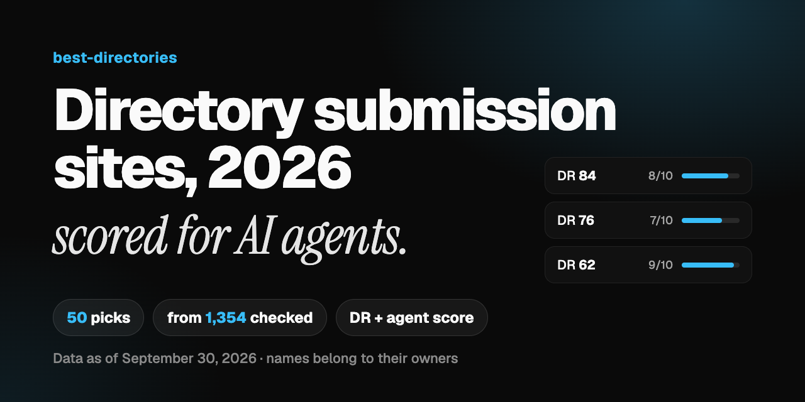

  

<h1 align="center">Directory Submission Sites 2026</h1>

  <b>50 places to submit your startup, SaaS or AI tool, each with its Domain Rating and an agent score: 
  how easily an AI agent, or you, gets from the submit page to a sent submission.</b>

  
  
  

  <a href="#ai-tool-directories">AI tools</a> ·
  <a href="#web-directories">Web</a> ·
  <a href="#launchpads">Launchpads</a> ·
  <a href="#startup-and-saas-directories">Startup & SaaS</a> ·
  <a href="#niche-directories">Niche</a> ·
  <a href="#submit-to-all-of-them-without-the-forms"><b>Skip the forms</b></a>

Directory submission means listing your product on sites that catalogue software: launch platforms, AI tool directories, startup and SaaS directories, web directories and niche lists. Each accepted listing can bring a backlink, referral visitors and a page people find when they compare tools.

These 50 were picked at random from a checked list of 1,354 directories and launchpads, leaving out the paid-only and closed ones, and sorted by Domain Rating within each type. At the check, 17 were free, 31 were free with paid upgrades and 2 had unknown pricing.

## How to read the scores

| Score | What it means |
| --- | --- |
| **DR** | Ahrefs Domain Rating (0 to 100) on September 30, 2026. Higher means a stronger site |
| **10** | Public form, no login, no CAPTCHA, one step |
| **9** | Public form or one-click sign-in, no CAPTCHA |
| **8** | Quick sign-in (often Google), then a short form |
| **7** | A login or a CAPTCHA you clear once, or a manual review queue |
| **6** | Login plus CAPTCHA, or many steps and uploads |
| **3 to 5** | Hard: the free path is mostly closed, the form is blocked, or challenge pages get in the way |

## AI tool directories

Directories that list AI products: assistants, agents, models and AI-powered apps. 13 in this sample.

| Directory | DR | Agent score | Pricing |
| --- | ---: | :---: | --- |
| [Submit AI Tools](https://submitaitools.org) | 76 | 7/10 | Free + paid |
| [Pitchwall](https://pitchwall.co) | 68 | 7/10 | Free + paid |
| [Whatisaitools](https://whatisaitools.com) | 55 | 8/10 | Free + paid |
| [AgentWork.Tools](https://agentwork.tools) | 50 | 7/10 | Free + paid |
| [Power Up Tools](https://poweruptools.com) | 48 | 8/10 | Free |
| [AI Directory](https://ai-directory.com) | 44 | 3/10 | Free |
| [Super AI Boom](https://superaiboom.com) | 40 | 8/10 | Free |
| [Liaise Platform](https://liaiseplatform.com) | 33 | 4/10 | Free |
| [Hotools](https://hotools.com) | 32 | 7/10 | Free + paid |
| [Aisupersmart](https://aisupersmart.com) | 27 | 7/10 | Free |
| [Maomu](https://maomu.com) | 19 | 8/10 | Free + paid |
| [AI Kendra](https://aikendra.com) | 1 | 7/10 | Free + paid |
| [Wioai.com](https://wioai.com) | 0 | 9/10 | Free |

## Web directories

General web directories. Lower priority for most software products, but many are quick to finish. 17 in this sample.

| Directory | DR | Agent score | Pricing |
| --- | ---: | :---: | --- |
| [Cybo](https://cybo.com) | 75 | 4/10 | Free |
| [AddonBiz](https://addonbiz.com) | 62 | 8/10 | Free |
| [Member Directory](https://biztobiz.org) | 58 | 6/10 | Free |
| [Localpages](https://localpages.com) | 50 | 6/10 | Free |
| [Zjnav](https://zjnav.com) | 48 | 6/10 | Free + paid |
| [Beegdirectory](https://beegdirectory.com) | 38 | 7/10 | Free + paid |
| [Hitwebdirectory](https://hitwebdirectory.com) | 36 | 6/10 | Free + paid |
| [Alivelinks](https://alivelinks.org) | 34 | 7/10 | Free + paid |
| [Searchdomainhere](https://searchdomainhere.com) | 34 | 7/10 | Free + paid |
| [webspot](https://webspot.app) | 32 | 7/10 | Free + paid |
| [Newwebdirectory](https://newwebdirectory.com) | 32 | 5/10 | Unknown |
| [In Sla](https://in-sla.org) | 23 | 6/10 | Unknown |
| [Backlinkhubs](https://backlinkhubs.com) | 22 | 7/10 | Free + paid |
| [Olarex](https://olarex.eu) | 7 | 6/10 | Free + paid |
| [Diyodp](https://diyodp.com) | 2 | 9/10 | Free |
| [Widedir](https://widedir.info) | 2 | 8/10 | Free + paid |
| [Iqdir](https://iqdir.com) | 1 | 7/10 | Free + paid |

## Launchpads

Launch platforms with a launch day, a feed or votes. 9 in this sample.

| Directory | DR | Agent score | Pricing |
| --- | ---: | :---: | --- |
| [LaunchIgniter](https://launchigniter.com) | 75 | 6/10 | Free + paid |
| [Maidensail](https://maidensail.com) | 67 | 7/10 | Free |
| [Indiehunt](https://indiehunt.io) | 64 | 7/10 | Free + paid |
| [LaunchBoard](https://launchboard.dev) | 51 | 7/10 | Free + paid |
| [Aisofto](https://aisofto.com) | 32 | 6/10 | Free + paid |
| [FridayHunt](https://fridayhunt.com) | 29 | 7/10 | Free + paid |
| [AI of The Day](https://aioftheday.com) | 9 | 7/10 | Free + paid |
| [Slocco](https://slocco.com) | 5 | 6/10 | Free + paid |
| [Oksaas](https://oksaas.co) | 2 | 9/10 | Free + paid |

## Startup and SaaS directories

Directories for startups and software products of any kind. 7 in this sample.

| Directory | DR | Agent score | Pricing |
| --- | ---: | :---: | --- |
| [Startup Fame](https://startupfa.me) | 84 | 8/10 | Free + paid |
| [Startup Stash](https://startupstash.com) | 65 | 7/10 | Free + paid |
| [directree](https://directree.io) | 62 | 9/10 | Free |
| [verifiedtools](https://verifiedtools.info) | 54 | 6/10 | Free + paid |
| [Ash List](https://ashlist.com) | 43 | 7/10 | Free |
| [CurateClick](https://curateclick.com) | 41 | 7/10 | Free + paid |
| [Toolkit Index](https://toolkitindex.com) | 26 | 8/10 | Free |

## Niche directories

Lists for one audience or category. Submit when the niche matches your product. 4 in this sample.

| Directory | DR | Agent score | Pricing |
| --- | ---: | :---: | --- |
| [shno](https://shno.co) | 69 | 7/10 | Free |
| [Sprout24](https://sprout24.com) | 60 | 3/10 | Free |
| [Infrabase](https://infrabase.ai) | 28 | 10/10 | Free + paid |
| [Androidappsreview](https://androidappsreview.com) | 27 | 4/10 | Free + paid |
## How to get listed on 50 directories in an afternoon

1. **Write one product brief.** Name, a tagline under 60 characters, a 160-character description, a 120 to 200-word long description, 5 to 8 tags and your categories. Every form pulls from it.
2. **Prepare your assets.** A square logo (512×512 is ideal) and 2 to 3 real screenshots in one folder.
3. **Use one Google account for the product**, signed in to a dedicated browser profile. Most directories offer *Continue with Google*.
4. **Keep the inbox open.** Many directories send a confirmation email, and those links often expire within 24 to 72 hours.
5. **Make room for badges.** Many directories list you for free, or only give a dofollow link, when their "Featured on" badge is on your site. A footer slot saves you editing the site for each one.
6. **Track every submission** with the date, the status and the listing URL, then check back after one day, one week and one month.

## Submit to all of them without the forms

These 50 come from a list of **1,354 directories and launchpads**. Each row of it carries, where known, the submit URL, the sign-in methods, the CAPTCHA type, pricing, the badge rule and practical notes.

The **[Claude Directory Submission Skill](https://saascity.io/claude-directory-submission-skill?from=github-best-directories)** hands that list to your own AI agent, Claude Code, Codex, Devin or Cursor, together with a playbook: it picks the directories that fit, writes the copy, fills each form in a real browser you watch and submits once you say yes. You sign in and clear CAPTCHAs; it never pays.

  

More about the skill: [nyyhao/claude-directory-submission-skill](https://github.com/nyyhao/claude-directory-submission-skill).

## More lists

- **[Product Hunt alternatives](https://github.com/best-directories/product-hunt-alternatives)**: launch platforms and startup directories to launch on
- **[Best SaaS directories](https://saascity.io/best-saas-directories)**: where to list a SaaS product
- **[Best AI directories](https://saascity.io/best-ai-directories)**: where to list an AI tool

## FAQ

<b>What is a directory submission site?</b>

 
A website that lists products, usually by category, and lets makers submit theirs through a form. Launch platforms add a launch day, a feed or votes on top.

<b>Do directory submissions still help in 2026?</b>

 
They can. An accepted listing can bring a backlink, referral visitors and a page that shows up when people compare tools. The link type is each directory's call: some give dofollow links, some only with their badge, some nofollow, and any of them can change it.

<b>Are these directories free?</b>

 
None of the 50 was paid-only at the check: 17 were free and 31 had a free way in plus paid upgrades. Pricing changes often, so check before you submit.

<b>What is the agent score?</b>

 
A 1 to 10 rating of how smoothly an agent in a real, visible browser gets from the submit page to a sent submission, with a human there for CAPTCHAs and sign-ups. 10 is a public form with no login; 1 means the site was down or closed at the check.

<b>Can I suggest a directory?</b>

 
Yes, open an issue with the name and the link.

---

  Data as of September 30, 2026, from the list in the <a href="https://saascity.io/claude-directory-submission-skill?from=github-best-directories">Claude Directory Submission Skill</a> by SaaSCity. Directory names belong to their owners.

